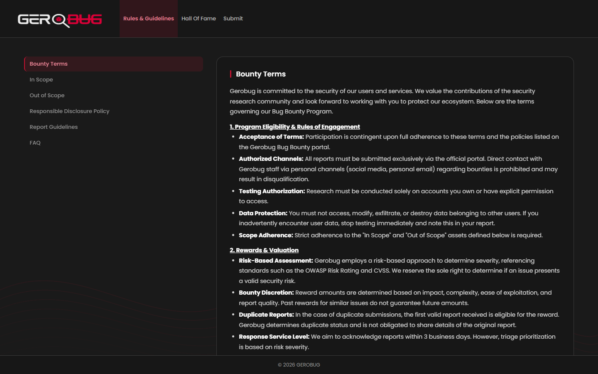

# What is GEROBUG?

The First Open Source Self-managed Bug Bounty Platform.

Are you a company, planning to have your own bug bounty program, with minimum budget?

**We got you!**

We are aware that some organizations have had difficulty establishing their own bug bounty program. Using a third-party managed platform usually comes with a hefty price tag and increased security concerns. Building your own platform, on the other hand, takes time and effort to build and maintain.

This is where **Gerobug** takes part. Gerobug is an independent, self-hosted platform: a company only needs **one command** to install it and launch a private bug bounty program.

## TL;DR

Gerobug is FREE and helps companies start and manage their own bug bounty program within minutes.

## What's New in v4.0

* **Eleven hunter email commands**, including three new ones: `HELP` (or
  `COMMANDS`) for the command list and remaining allowances, `COMMENT_` to ask
  the team a question without spending an update, and `WITHDRAW_` to take a
  report back while it is still in review. See
  [Bug Hunter Guide](bug-hunter-guide.md).
* **Forgiving subjects.** `Re:`, `Fwd:`, `[EXT]`, lower case, spaces inside a
  Report ID and a trailing word are all accepted, and folded long subjects are
  unfolded before the command is read.
* **`CHECK_` replies with a status card**: the stage and since when, what is
  needed next with a one-click button, the remaining allowances, every
  submission the hunter sent, and the last message the program sent.
  `STATUS_OVERVIEW` is an index with a "Needs you" column.
* **Severity-weighted Hall of Fame.** Points are the severity score, rounded
  down, times 1 for Low, 2 for Medium, 3 for High and 4 for Critical, with an
  operator tool to set, hide, recompute or delete. See
  [Hall of Fame](hall-of-fame.md).
* **Auto-accept and reminders.** A bounty calculation with no appeal for 30 days
  counts as agreed, the countdown shows on the report page and the Kanban card,
  and **Send Reminder** nudges the hunter.
* **Troubleshooting tools** for admins: Resend Email, Override Report Fields,
  Hunter Email Sinkhole, Hall of Fame, file recovery and Server Logs.
* **Mail intake hardening.** Sender authentication from the mail server's
  verdict, report time from the mail server rather than the sender's `Date:`
  header, bounce handling that cannot blacklist a hunter, display-name
  screening, message and MIME size limits, and an `ALLOWED_HOSTS` allowlist.
  See [Filter & Validation](filter-and-validation.md).

<figure><figcaption>
The public Rules and Guidelines page
</figcaption></figure>

Upgrading from v3.x? Read [Upgrading](upgrading.md) first.

## Main Features

* **Network segregation.** Public pages, dashboard, database and reverse proxy run in separate containers. The public only reaches the static Rules, Submit and Hall of Fame pages.
* **Email-based submission.** Bug hunters submit and follow up on reports by email with eleven commands. Gerobug parses, filters and shows them on the dashboard. Hunters never get an account, so there are no hunter credentials to leak.
* **Self-documenting Submit page** with every command, its subject, its body format, the real limits and an "Open in mail app" button per command.
* **Encrypted credentials.** Mailbox passwords and notification webhook URLs are encrypted at rest in the database.
* **Automated HTTPS** with NGINX and Let's Encrypt, including optional monthly auto-renewal.
* **Auto reply and notifications** for bug hunters on every action and status change, threaded per report and answered exactly once.
* **Slack and Telegram notifications** for new reports, updates, appeals, agreements, submitted data and email delivery failures.
* **Role-based user management** (Admin and Reviewer).
* **Kanban dashboard** with drag-and-drop, search, severity filter, aging indicators and an auto-accept countdown.
* **Bounty prerequisites and NDA.** Request the documents you need before paying a bounty, with or without an NDA.
* **Auto-accept after 30 days** of no appeal, with a Send Reminder button before the deadline.
* **Duplicate detection** that flags the later report and links it to the original.
* **CVSS 3.1, CVSS 4.0 and OWASP Risk Rating** calculators.
* **Email blacklisting** (rate limiting) for spammy senders.
* **Automatic certificates of appreciation.**
* **Personalization** with seven built-in themes, custom colors, company name and logo.
* **Troubleshooting tools** for admins: resend email, override report fields, hunter email sinkhole, Hall of Fame management, file recovery and an in-dashboard log viewer.
* **Logging with daily rotation.**
* **Hall of Fame** leaderboard with severity-weighted points and hidden hunters.

## Source Code

[https://github.com/gerosecurity/gerobug](https://github.com/gerosecurity/gerobug) (AGPLv3)
