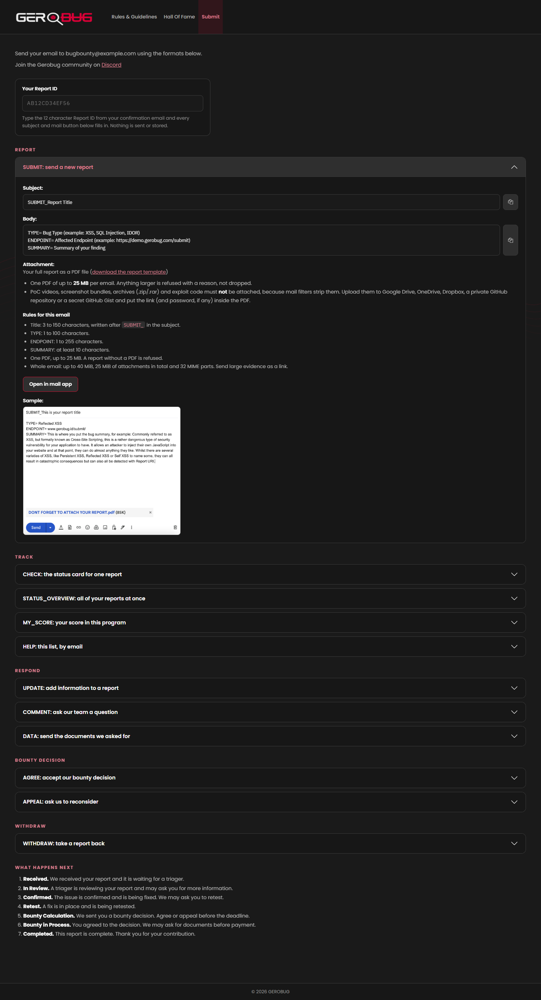

# Bug Hunter Guide (Email Commands)

Bug hunters interact with Gerobug only by email. The program's address and every
command below are shown on the public page `https://[your-domain]/submit/`.

<figure><figcaption><p>The public Submit page: Report ID box, grouped commands and the SUBMIT rules</p></figcaption></figure>

Each command is identified by the **email subject**. A subject Gerobug cannot
read is answered with an explanation and a pointer to `HELP`, never ignored.

## The Eleven Commands

| Subject | What it does |
| --- | --- |
| `SUBMIT_<Report Title>` | Send a new report |
| `CHECK_<Report ID>` | Status card for one report |
| `STATUS_OVERVIEW` | Index of every report you sent |
| `MY_SCORE` | Your score in this program |
| `HELP` (or `COMMANDS`) | This list, by email |
| `UPDATE_<Report ID>` | Add information to a report |
| `COMMENT_<Report ID>` | Ask the team a question |
| `DATA_<Report ID>` (or `NDA_<Report ID>`) | Send the requested documents |
| `AGREE_<Report ID>` | Accept the bounty decision |
| `APPEAL_<Report ID>` | Ask for the decision to be reconsidered |
| `WITHDRAW_<Report ID>` | Take a report back while it is in review |

### Forgiving subjects

Gerobug normalises the subject before it reads the command:

* Reply and forward prefixes are stripped: `Re:`, `Fw:`, `Fwd:`, `Aw:`, `Sv:`,
  `Wg:`, `Tr:`, `Rif:`, and bracketed tags such as `[EXT]` or `[EXTERNAL]`.
* Case does not matter: `check_ab12cd34ef56` works.
* The separator can be `_`, `:`, `-` or a space: `CHECK AB12CD34EF56`.
* Spaces inside the Report ID are removed.
* A trailing word after the Report ID is ignored, so `CHECK_AB12CD34EF56 thanks`
  works.
* Folded subjects (mail clients wrap a subject longer than about 69 characters
  onto two lines) are unfolded before the command is read.

Every Gerobug email that asks the hunter for something carries a subject the
hunter can simply reply to, for example `UPDATE_<Report ID> | Action Required`.
Replies are threaded, so one report stays in one conversation.


An inbound email is answered once. Gerobug deduplicates by `Message-ID`, so
marking the mailbox unread does not make it reply again.


## Submit a Report

```
Subject: SUBMIT_<Report Title>
Body:
TYPE= Bug type (example: XSS, SQL Injection, IDOR)
ENDPOINT= Affected endpoint
SUMMARY= Summary of the finding

Attachment: PDF report file (use the report template)
```

| Field | Limit |
| --- | --- |
| Title (after `SUBMIT_`) | 3 to 150 characters |
| `TYPE` | 1 to 100 characters |
| `ENDPOINT` | 1 to 255 characters |
| `SUMMARY` | at least 10 characters |
| Attachment | exactly one valid PDF, up to 25 MB |

The body is parsed line by line, so lower case labels, `:` or `-` instead of
`=`, and markdown bold around a label all work.

The hunter receives a confirmation with the **Report ID**: 12 letters and digits,
randomly generated. It is needed for every other command.


Do not attach PoC videos, archives (.zip/.rar), screenshot bundles or exploit
code: mail filters strip them. Upload them to Google Drive, OneDrive, Dropbox, a
private GitHub repository or a secret Gist, and put the link (and password, if
any) inside the PDF.


Refusals say what is wrong: a PDF over the limit states its own size, a non-PDF
attachment says so, and a short submission names the field. Inline signature
images, archives and text files are skipped while looking for the attachment, so
the real PDF behind them is still found. Nothing is counted or stored until a
submission has passed validation, so a rejected appeal does not burn an appeal.

## Check One Report (Status Card)

```
Subject: CHECK_<Report ID>
```

The reply is a card containing:

* The stage the report is at, and since when.
* What Gerobug needs from the hunter next, with a one-click button for it.
* The remaining update, appeal and question allowances.
* Every submission the hunter has sent (original report, updates, appeals, data,
  questions), with dates.
* The last message the program sent.

The card is built from an allowlist of fields, so triage internals cannot leak
into it.

## Check All Reports (Overview)

```
Subject: STATUS_OVERVIEW
```

An index of every report the sender has, with Report ID, title, status and a
**Needs you** column. Reports that need the hunter are listed first, and each
Report ID is a link that asks for that report's card.

A sender with no reports gets a "No Reports Yet" reply, not an authorization
failure.

## Update a Report

```
Subject: UPDATE_<Report ID>
Body: Summary of the update
Attachment: PDF (optional if the body explains the update)
```

* **3 self-initiated updates per report.** An update the program requests with
  Request Amend is free and does not count.
* Accepted until the report leaves Bounty Calculation. Later than that the reply
  is "Updates Closed" and names the current stage.
* Text, a PDF, or both. One PDF of up to 25 MB.
* Once the allowance is spent the reply is "Update Limit Reached".

## Ask a Question

```
Subject: COMMENT_<Report ID>
Body: Your question
```

* Does not use up one of the 3 updates.
* **10 questions per report.**
* Text only. A PDF attached to a question is not stored, so send evidence with
  `UPDATE_` instead.
* Allowed while the report is open (Need to Review through Bounty in Process).
  On a closed or completed report the reply says questions are closed and names
  the stage.

Questions appear on the report page in the dashboard.

## Appeal a Bounty Calculation

```
Subject: APPEAL_<Report ID>
Body: Reason for the appeal
```

Only after a bounty calculation has been sent. **3 appeals per report.** Every
appeal confirmation states how many are left; a fourth gets "Appeal Limit
Reached: the determination is final", not an authorization failure.

Send it within 30 days of the decision email, because after that the decision
counts as agreed.

## Agree to a Bounty Calculation

```
Subject: AGREE_<Report ID>
Body: leave it empty
```

The report moves to Bounty in Process and one confirmation naming the new stage
is sent.


A plain reply to the decision email is not agreement. Send `AGREE_` or
`APPEAL_`, so there is no doubt which one was meant. With no appeal for 30 days
the calculation is accepted automatically.


## Submit Data and NDA

```
Subject: DATA_<Report ID>
Body: Requested information
Attachment: Signed NDA PDF (required only if an NDA was requested)
```

Only after the program has requested prerequisites. The older `NDA_<Report ID>`
subject is still accepted.

## Withdraw a Report

```
Subject: WITHDRAW_<Report ID>
```

Closes a report the hunter no longer wants pursued, while it is still at **Need
to Review** or **In Review**. It drops every open grant and is recorded as a
withdrawal, not as an invalid report. Later than that the reply names the current
stage and offers a plain reply instead.

A withdrawal is reversible by the program from
[Troubleshooting > Override Report Fields](troubleshooting.md#override-report-fields),
and the hunter may send the finding again later with a new `SUBMIT_`.

## Check Score

```
Subject: MY_SCORE
```

Returns the hunter's total points. Each completed report adds its severity
score, rounded down, times a weight: **Low 1, Medium 2, High 3, Critical 4**. A
Critical 9.8 adds 36 points. See [Hall of Fame](hall-of-fame.md).

## Help

```
Subject: HELP
```

(or `COMMANDS`.) Replies with every command, a one line description of each, and
the remaining allowances of each report the sender still has open. A sender with
no reports gets the command list only.

## One-Click Buttons

Emails that ask the hunter for something carry a button that opens a pre-filled
email in their mail client: **update**, **agree**, **appeal** and **send data**.
The status card and the HELP reply carry the same buttons. The public Submit page
has a Report ID box that fills the ID into every subject and button on the page;
nothing is sent or stored, the ID stays in the browser.

## Replies the Hunter Can See

| Reply | Meaning |
| --- | --- |
| Report Submission Confirmed | Report saved, with its Report ID |
| Status of Report | The status card for one report |
| Submission Summary: Report Overview | The index of all reports |
| Confirmation: Update / Appeal / Agreement / Documents Received | Submission accepted, with the remaining allowance |
| Question Received | A `COMMENT_` reached the team |
| Report Withdrawn | A `WITHDRAW_` closed the report |
| Gerobug Commands: What You Can Send Us | The `HELP` reply |
| No Reports Yet | `MY_SCORE` or `STATUS_OVERVIEW` from a sender with no reports |
| We could not process your email | Unknown or unreadable subject, missing or invalid PDF, fields too short or too long. If the subject started with a known command, the reply names that command |
| Submission Error: Invalid Report ID | The Report ID does not exist |
| Authorization Failure | The report belongs to another address, or the action was not requested |
| Update Limit Reached | The 3 self-initiated updates are used; wait for an amend request |
| Updates Closed | The report has moved past Bounty Calculation |
| Appeal Limit Reached | 3 appeals used; the determination is final |
| Question Limit Reached | 10 questions used for this report |
| Questions Closed | The report is closed or completed |
| Withdrawal Not Possible | The report has moved past In Review |
| Reminder: Bounty Decision | The program nudged the hunter about an open decision |
| Bounty Accepted by Default | No appeal within 30 days; the calculation was accepted |
| Submission Blocked: Temporary Restriction | Too many emails in a short time; the address is blocked temporarily |
