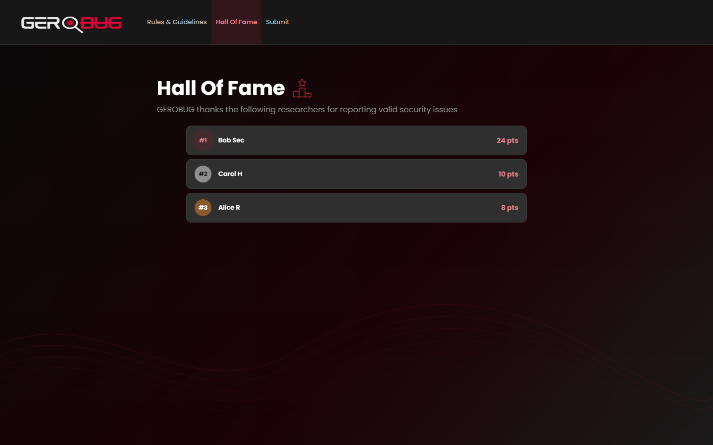

# Hall of Fame

The public Hall of Fame page lists hunters by points:
`https://[your-domain]/halloffame/`.

<figure><figcaption>
The public Hall of Fame page
</figcaption></figure>

## How Points Are Awarded

A completed report adds its severity score, **rounded down**, times a band
weight:

| Severity band | Score range | Weight |
| --- | --- | --- |
| Low | 0.1 to 3.9 | 1 |
| Medium | 4.0 to 6.9 | 2 |
| High | 7.0 to 8.9 | 3 |
| Critical | 9.0 to 10.0 | 4 |

So `int(score) x weight`: a Critical 9.8 adds 36 points, a High 7.5 adds 21, a
Medium 6.1 adds 12, a Low 3.2 adds 3. An informational finding (score 0) adds
nothing.

## Scores Stay in Sync With Completed

The award happens in one place, when a report's status changes:

* Completing a report awards its points to the hunter.
* Moving a report back out of Completed takes exactly those points away again.
* Every path is covered: the completion email, the Kanban board, and
  Troubleshooting > Override Report Fields.
* A score can never go below zero.

Each report records the points it currently contributes, so a later move out of
Completed subtracts the right amount even if the severity changed in between.

## Operator Tool

Found at **Settings > Troubleshooting > Hall of Fame**.

Admin (superuser) only. Search hunters by email or name, or leave the box blank
for the top hunters. The table shows each hunter's name, email, current score,
number of completed reports, the score a recompute would produce, and whether
they are hidden. Per hunter:

* **Set score.** Enter a whole number (0 or more).
* **Hide / Show.** A hidden hunter does not appear on the public Hall of Fame
  page, but keeps their score and still receives `MY_SCORE` replies with their
  real score.
* **Recompute.** Recalculates that hunter's score from their completed reports.
* **Delete.** Only a hunter with no reports at all. A hunter with reports can
  only be hidden, so their certificates can still be resent.

**Recompute all** recomputes every hunter from their completed reports. It
overwrites manual corrections and cannot be undone, so it needs a typed
`RECOMPUTE` confirmation.

Every action here is written to the server log with the old and new values and
the username that performed it.


Hunters with a score of 0 are not listed on the public page.

