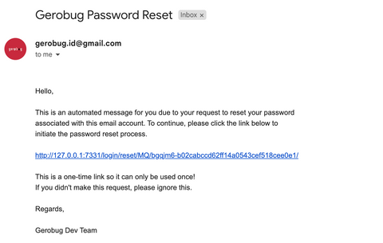

# Initial Access

## Accessing the Homepage

Homepage: `https://[Your Gerobug Domain]/`

The homepage should be **the only page** that is **needed** and **accessible** by the **Bug Hunter**. They can read and get to know about the bug bounty program rules and guidelines, access the hall of fame, and get comprehensive instructions on how to submit or follow up on their report(s).

<figure><figcaption>
Rules and Guidelines Page
</figcaption></figure>

<figure><figcaption>
Hall of Fame Page
</figcaption></figure>

<figure><figcaption>
Submission Guidelines Page
</figcaption></figure>

## Accessing the Dashboard

Dashboard Login Page: `https://[Your Gerobug Domain]:6320/login`

If you chose **YES** on having a VPN Server within the [installation](./) process, the Gerobug dashboard will **not accessible by public**

<figure><figcaption>
<strong>You need to connect to your VPN Server on the same network of Gerobug Server to access the dashboard.</strong> 
</figcaption></figure>

**IMPORTANT**\
If you still receive 403 Forbidden even after using the VPN, you should add

`[INTERNAL IP]                         [GEROBUG DOMAIN]`

at `/etc/hosts` (Linux / MacOS) or _`C:\Windows\System32\drivers\etc\hosts`_ (Windows) \
on your local computer before accessing the dashboard.

<figure><figcaption>
For example, adding this line to /etc/hosts <strong>10.0.0.1                            demo.gerobug.com</strong>
</figcaption></figure>


**Why tho?**\
Because Gerobug Dashboard only accepts connection from internal IP, so we need to define on our host file to connect using our VPN internal IP instead of public IP\
\
or you can simply access Gerobug Dashboard from\
`https://[INTERNAL IP]:6320/login`\
(But the HTTPS won't work since it requires a Domain instead of IP Address)


<figure><figcaption>
Gerobug Dashboard Login Page
</figcaption></figure>

**Default Admin Credentials**

Username: `geromin`

Password will be randomly generated, check it on the initiation log

<figure><figcaption>
Password on the Initiation Log
</figcaption></figure>

or check the password manually:&#x20;

`cat gerobug/gerobug_dashboard/secrets/gerobug_secret.env`

This will be the main dashboard where reports will be shown as Kanban Board.&#x20;

<figure><figcaption>
Gerobug Dashboard
</figcaption></figure>


’Bounty Preparation’ column contains both ‘Bounty Calculation’ and ‘Bounty in Process’


_In this current version, you cannot add or remove columns_

## Forgot Password

<figure><figcaption>
Forgot Password Page
</figcaption></figure>

<figure><figcaption>
Sample Forgot Password Email
</figcaption></figure>

Forgot password functionality allows users to reset their password if they have forgotten it. This is accomplished by having the user enter their email address or username associated with the account, then sending them a link or code to reset their password. The link or code is sent via email. Once the user has clicked the link or entered the code, they will be prompted to create a new password. This process is designed to ensure that only the rightful owner of the account can reset the password.

Keep in mind that this feature will only work properly after the [mailbox being setup](../settings.md#mailbox-settings).

