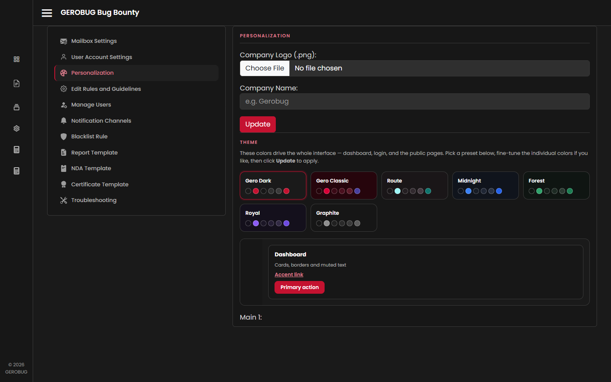
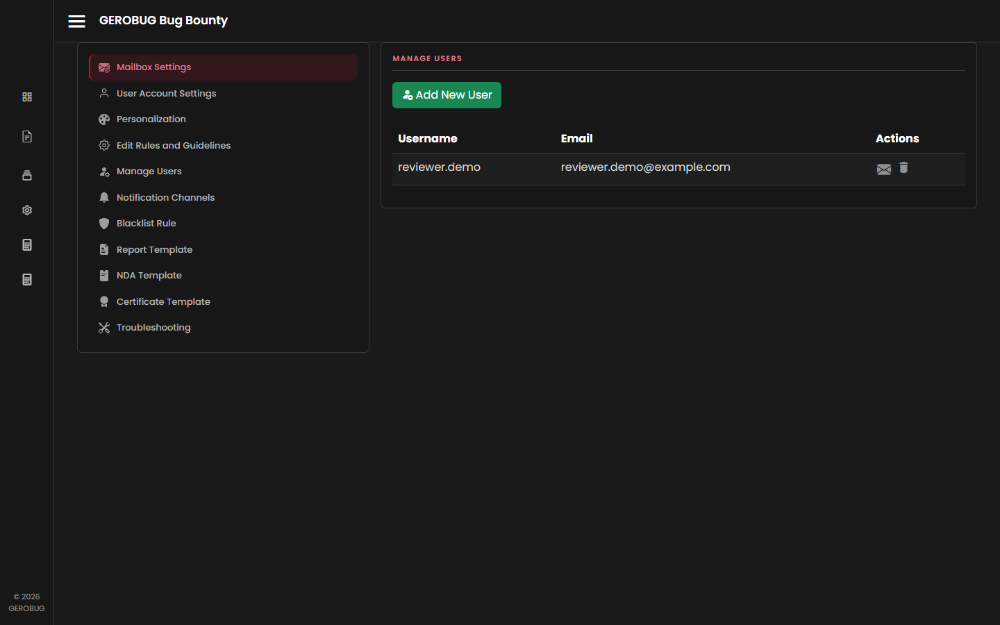
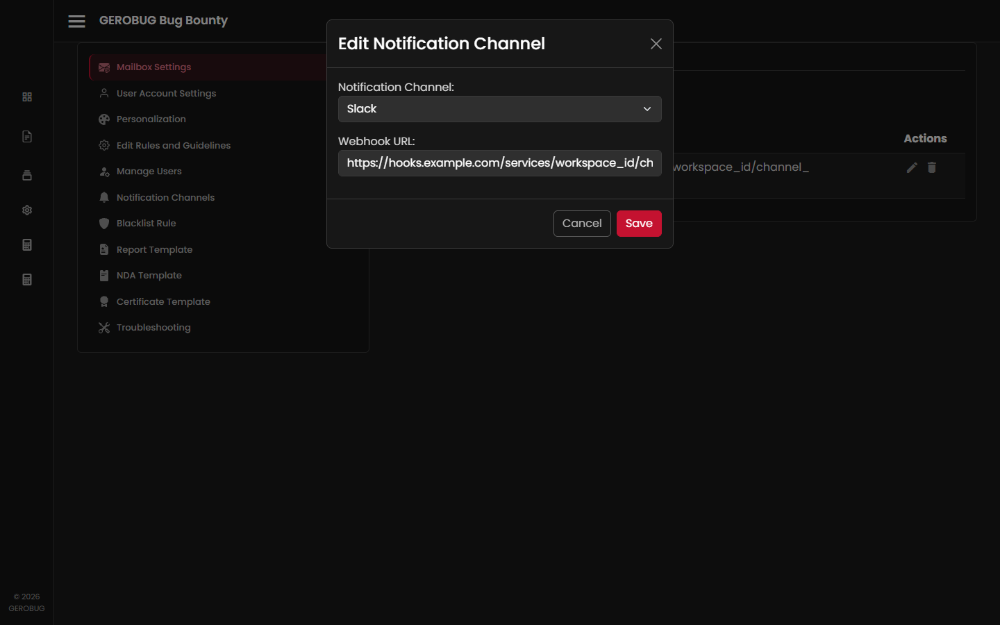

# Settings

**The Settings page is only accessible by the admin (superuser).** Reviewers do not see it. Settings remembers the last tab you opened.

## Mailbox Settings

Gerobug needs a mailbox to receive reports and send replies. Use a **dedicated** mailbox for the program and do not use it for anything else, to avoid conflicts during parsing.

| Email Type | IMAP | SMTP |
| --- | --- | --- |
| GMAIL | `imap.gmail.com:993` | `smtp.gmail.com:465` |
| OUTLOOK | `outlook.office365.com:993` | `smtp.office365.com:587` |
| CUSTOM | Your IMAP server and port (SSL) | Your SMTP server and port (SSL or STARTTLS) |

Gmail and Outlook require an [App Password](https://support.google.com/accounts/answer/185833), not your normal password. The password is stored encrypted.

IMAP connections verify the server certificate, so the IMAP host name must match the certificate the server presents.

When the mailbox connects successfully, its status becomes **ACTIVE**, and the program's address appears automatically on the public Submit Guidelines page.


For spoofing protection, use a mail provider that adds an `Authentication-Results` header to incoming mail (Gmail and Outlook do). See [Filter & Validation](filter-and-validation.md#sender-authentication).


## User Account Settings

Change the email and password of a user account.

## Personalization

* **Company identity.** Set the company name and upload a logo (PNG). Both are used on the public pages, the dashboard and generated certificates.
* **Theme presets.** Pick one of seven themes: **Gero Dark** (default), **Gero Classic**, **Route**, **Midnight**, **Forest**, **Royal** and **Graphite**. A live preview shows the result on a sample card. Picking a preset only fills the color pickers; nothing is saved until you click **Update**.
* **Custom colors.** Six colors drive the whole interface (dashboard, login and public pages): canvas background, accent, surface, overlay/hover, border and primary button.
* **Reset to Gero Dark** restores the default colors.

<figure> Personalization with the theme preset gallery"><figcaption><p>Settings > Personalization with the theme preset gallery</p></figcaption></figure>

## Edit Rules and Guidelines

Edit the public Rules and Guidelines page with a rich-text editor. Sections: Bounty Terms, In Scope, Out of Scope, Responsible Disclosure Policy, Report Guidelines and FAQ.

## Manage Roles

The admin can create and delete **Reviewer** accounts. Reviewers can review, triage and manage reports, but cannot open Settings.

* Usernames must be 3-30 characters, use only letters, numbers and `. _ -`, and start and end with a letter or number. Reserved names such as `admin`, `root` or `geromin` are rejected.
* Each reviewer needs a unique email address.
* A random password is generated for every new reviewer. If the mailbox is active, Gerobug emails the reviewer a **password reset link** so they set their own password. Otherwise, ask the reviewer to use **Forgot Password** on the login page.
* If that link expired or never arrived, use the **envelope** button on the reviewer's row to send a fresh one. It is not offered for the admin account and needs an active mailbox.

<figure> Manage Users with the resend reset link and delete buttons"><figcaption><p>Settings > Manage Users</p></figcaption></figure>

## Notification Channels

Gerobug sends notifications to Slack and/or Telegram for:

* New report
* New update/amend
* New appeal
* Hunter agreement (including automatic acceptance after 30 days)
* New NDA / data submission
* Email delivery failure (bounce), with the failed recipient, Report ID and SMTP error

Webhook URLs are stored encrypted.

To change a channel's webhook URL or service, use the **edit** button on its row. You no longer need to delete the channel and add it again. Each service can have one channel.

<figure><figcaption><p>Editing a notification channel</p></figcaption></figure>

### [Slack Webhook](https://api.slack.com/messaging/webhooks)

Format: `https://hooks.slack.com/services/<workspace_id>/<channel_id>/<token>`

### [Telegram Bot](https://core.telegram.org/bots)

Format: `https://api.telegram.org/bot<token>/sendMessage?chat_id=<channel_id>`

## Blacklist Rule

A simple rate limit that blocks email addresses sending too many emails.

| Field | Default | Meaning |
| --- | --- | --- |
| Max Counter | 10 | Emails allowed within the monitor window |
| Monitor Buffer | 60 seconds | Length of the monitor window |
| Blacklist Duration | 3600 seconds | How long an address stays blocked before automatic release |

A blocked hunter is told once that they are temporarily restricted. Keys are
compared without regard to case, and bounce notifications do not count toward a
sender's rate limit, so a forged bounce cannot get a hunter blacklisted.

## Report Template

Upload a report template (`.docx`) that hunters can download from the Rules and Guidelines page.

## NDA Template

Upload an NDA template (`.pdf`). It is sent to the hunter when you request prerequisites **with** an NDA.

## Certificate Template

Gerobug generates a certificate of appreciation automatically when a report is completed and emails it to the hunter.

You can replace the template (`.jpg`), but this is **not recommended**, since different sizing and positioning may break the generated certificate.

```
Default certificate template
Dimensions: 3508 x 2480
Resolution: 300x300
```

You can also set the officer name, title and signature (`.jpg` or `.png`). A sample certificate is regenerated after each change.

## Troubleshooting

Admin-only maintenance tools: **Recover Lost Report Files**, **Resend Email**,
**Override Report Fields**, **Hall of Fame**, **Hunter Email Sinkhole** and
**Server Logs**. See [Troubleshooting](troubleshooting.md) for each tool, and
[Hall of Fame](hall-of-fame.md) for how points are awarded.
